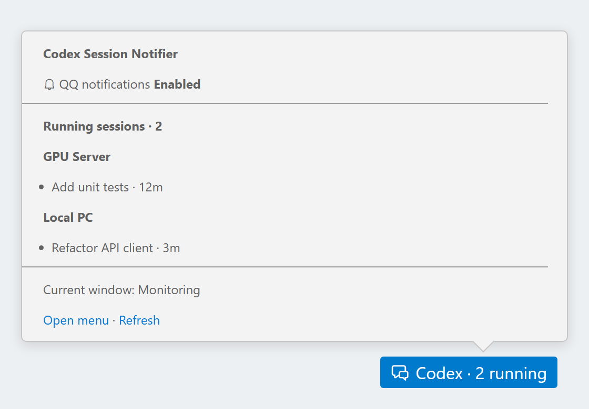

# Codex Session Notifier

[](https://marketplace.visualstudio.com/items?itemName=pp2zk.codex-session-notifier)
[](https://github.com/PP2zk/codex-session-notifier/issues)
[](LICENSE.txt)

Monitor VS Code Codex sessions locally and on Remote SSH hosts. Receive a pushplus notification through your chosen channel when a reply finishes, with the actual machine and session name in its details.

<p align="center">
  
</p>

## Status bar

Click the **Codex Session Notifier** status bar item at the bottom right to open the native VS Code Quick Pick at the top. The menu provides the notification switch, pushplus token setup, channel selection and test, refresh, logs, and settings. Test message review also uses Quick Pick, without centered native dialogs.

Hover over the item to see the selected channel, notification state, and running sessions grouped by machine, with their names and elapsed time. The list combines fresh snapshots from local and Remote SSH windows sharing this local state. A running session means an explicit Codex reply has started and has not ended, including a turn waiting for a tool or approval; recent file updates alone do not establish this state. The reader also verifies the executing backend.

Headings, status paragraphs, and footer links share a text inset; lists retain native indentation. Section spacing follows the native Agent Usage Bar layout. VS Code controls the outer padding and line wrapping. The hover stays native, including its possible brief replacement when visible content changes.

Activity already in progress at startup is discovered through bounded backward reads. Until its start marker or backend can be verified, it appears as an activity check rather than an invented running session. Sources without an update for 30 seconds are marked delayed and excluded from the running count. Local UI snapshots expire after 90 seconds; they contain names and IDs, never prompts, replies, or tokens. The notification outbox continues to store IDs and delivery metadata only.

Archived history is excluded from new activity candidates. A session already being monitored can have its final records checked in the native archive directory before its read cursor is retired; the existing completion evidence, backend verification, recovery window, and deduplication rules still apply. Archiving alone is not a completion signal.

An archive move can cause records to be read again after the backend closes the file. Already queued replies are recognized by the exact source, session, and turn IDs in the existing local outbox, before attempting source verification again. This prevents a misleading warning about a notification already processed. Unseen turns still require backend verification, including new turns in a file containing previously queued replies. No additional remote state or service is installed.

If the current window says **Some completion notifications await source verification**, a completion record was found but could not be associated with an existing Codex backend on that machine. That notification is withheld and retried within the existing recovery window; other sessions continue monitoring. Open the status bar menu and choose **Show logs** for the UTC timestamp, machine, source ID, session name and ID, turn IDs, verification stage, and any OS error code. These diagnostics stay in the local output channel. A missing backend observation alone cannot distinguish synchronized history from a transient inspection failure; this message is unrelated to Codex command approval or notification transport.

Activity has its own persisted read position and runs before completion replay, so a busy notification cursor cannot starve the running-session list. Normal scans read at most 1 MiB and process at most 100 records. During initial lifecycle backfill, bounded batches can read up to 8 MiB, with a 250 ms pause between successful unfinished scans; the reader still reserves space for notification replay. After backfill, normal five-second polling resumes. Unknown backend bindings and invalid metadata do not trigger fast retries. UI snapshots from older versions cannot overwrite this activity state. Unchanged hover text is not reassigned; machine and session ordering is stable and elapsed time changes at minute resolution.

While a new window initializes, the status bar menu remains available. The first hover waits for real saved settings and the source's initial status; it does not briefly display guessed notification settings or an empty session list. A short settling period combines initial discoveries and transient diagnostics, capped at eight seconds after the first snapshot becomes available. Scan status follows activity publication, and subsequent UI changes are combined within 100 ms. Concurrent refresh requests wait for the latest read. Errors remain visible, and later session changes continue updating normally.

## Notifications

The title is the session name, without a machine name or generic prefix. For example:

> Fix training resume

The details contain:

> Codex reply complete | Machine: gpu-server-02 | Session: Fix training resume | Completed: 2026-11-01T11:30:00Z

Commands, dialogs, settings descriptions, status messages, and fixed notification text are in English. Session names and machine labels keep their original language. Unnamed sessions use an explicit short-ID fallback. Long titles are shortened to fit the request budget; details retain a longer name.

Only machine labels, session names, completion status, and time leave your computer. Prompts, replies, code, working directories, and raw logs are excluded. A timestamp distinguishes successive replies in the same session.

## Install and enable

If you installed the earlier local preview with ID
`codex-session-notifier.codex-session-notifier`, disable and uninstall it before
installing `PP2zk.codex-session-notifier`, then reload all VS Code windows.
The new publisher gives the extension a new identity: enter your pushplus token,
choose your channel, and enable notifications again. Settings under
`codexSessionNotifier.*` keep their existing names.

1. Install [Codex Session Notifier](https://marketplace.visualstudio.com/items?itemName=pp2zk.codex-session-notifier) from the VS Code Marketplace. For manual installation, download the VSIX from [GitHub Releases](https://github.com/PP2zk/codex-session-notifier/releases) and choose **Install from VSIX...** in your local desktop VS Code.
2. Bind your preferred receiving channel on the pushplus website. QQ remains the default. Other users can choose **Select Notification Channel** from this extension's status bar menu or Command Palette.
3. Run **Codex Session Notifier: Configure pushplus Token**. Enter a dedicated message token or your user token from the [one-to-one messaging page](https://www.pushplus.plus/push1.html). It is stored in local VS Code SecretStorage. Upgrades under the same extension ID retain the saved token.
4. Optionally run **Send Test Notification** and check the received details. Sending a test always requires a Quick Pick confirmation. Tests are not required to enable a channel.
5. Choose **Enable notifications** in this extension's status bar menu, or run **Enable Notifications**. Only replies completed after enabling are eligible. The selected channel and switch apply to windows sharing this local state and remain saved after restart.

See [pushplus channel setup](docs/PUSHPLUS.md) for channel prerequisites, configuration codes (`option`), paid channels and validation limits. Select one channel at a time; switching channels disables automatic delivery until you enable it again. Reload all existing VS Code windows after upgrading before changing channels. Requests already submitted can still arrive through the previous channel.

The extension runs in the local UI host and starts with VS Code. No notification program, hook, package, or persistent service is installed remotely.

| Component | Requirement and reason |
| --- | --- |
| VS Code | 1.73+ for the existing hover command allowlist (`MarkdownString.isTrusted.enabledCommands`). Quick Pick, SecretStorage, and monitoring use older APIs. The extension compiles against 1.73 API types; desktop integration has been tested on 1.142 and 1.144, rather than every older release. |
| Codex IDE extension | Follow its own editor requirement. The installed Codex extension `26.1021.22027` declares VS Code 1.96.2+; this is separate from this notifier's API baseline. |
| Local Python | 3.7+ with `sqlite3`, and SQLite 3.24+ for local atomic UPSERTs. `datetime.fromisoformat` sets the current Python API floor. Windows integration is tested with Python 3.11.5. |
| Remote Python | 3.7+ with `sqlite3` and existing non-interactive SSH access. Read-only scans are verified on Python 3.8.10 and 3.10.12. Remote scanning does not write the notifier's local SQLite database. |
| Node.js | VS Code supplies the runtime. Users do not need a separate Node installation. Node.js 22+ is only a development/build requirement. |

Codex version numbers are diagnostic information, not an installation or scanning gate. New or absent version fields and additional unrelated fields do not block the known record format. The current adapter uses `state_5.sqlite` with the required thread identity, source, rollout path, and update-time columns, and explicit `task_started` / `task_complete` / `turn_aborted` records. It verifies session identity and the existing executing backend; missing identities, unknown terminal statuses, failed/interrupted turns, and incompatible metadata do not become successful completion notifications. Names remain optional, with the existing explicit fallback.

Real format samples have been checked on `0.160.0`, `0.162.0-alpha.2`, `0.162.0-alpha.17.2`, and `0.164.0-alpha.11.1`; these are tested examples, not an exhaustive compatibility list. OpenAI [documents that the transcript format can change](https://learn.chatgpt.com/docs/hooks#common-input-fields). A change to the actual database or event format can still require an adapter update; ordinary version changes alone do not. Diagnostics identify missing databases, incompatible schemas, session metadata mismatches, or missing lifecycle identities instead of rejecting an unfamiliar version number.

## Source settings

Store settings locally once. Use `codexSessionNotifier.sources` to override the data directory and display label for `local` or an existing SSH Host alias:

```json
{
  "codexSessionNotifier.sources": {
    "local": { "machineLabel": "My PC" },
    "gpu-server": { "machineLabel": "GPU server", "codexHome": "/home/me/.codex" }
  }
}
```

An empty label uses the actual hostname returned by the reader. `sshExecutable` selects an existing local SSH client; the Git-bundled client passed the checks in this Windows environment. `pythonExecutable` selects an existing local Python. Other settings include `enabled`, `codexHome`, and `sshHost`.

A symlinked Codex home is resolved automatically. For example, `/home/user/.codex` pointing to `/data/user/.codex` uses the same source identity as the real directory. No directory move or extra source configuration is needed for this layout. Files must remain inside the matching native `sessions` or `archived_sessions` store.

Simple Remote SSH authorities are discovered from the current workspace. Complex authorities and custom paths can need a one-time override. Full Remote SSH window lifecycle and multi-host acceptance remain unverified. An unidentified remote source never falls back to the local computer. Set `codexSessionNotifier.enabled=false` to stop this window's monitor.

## Delivery and troubleshooting

- **Disable Notifications** turns off automatic delivery in windows sharing this local state. A request already submitted may still arrive.
- **Show Delivery Status** reports local acceptance, unknown results, and any paused channel. Provider acceptance does not confirm recipient receipt.
- **Remove pushplus Token** disables automatic delivery and deletes the local credential; it leaves the website binding unchanged. Replacing a token also disables delivery until you enable it again.
- **Show Status** opens the bounded local monitor output. **Inspect Source** runs a small, read-only source diagnostic.

The local SQLite outbox atomically deduplicates replies across windows. Automatic requests are spaced at least 13 seconds apart. A crash before HTTP submission can be retried; a crash or timeout after submission becomes unknown and is not blindly resent. Explicit provider rejection pauses delivery. Check your pushplus account's records and limits before using Enable again for future notifications. No extra Open API management credential is requested for result lookup.

Offline completions can be recovered only with explicit completion evidence, within the 30-minute recovery window. On restart, pending names are read from specific metadata columns through the existing reader. Names and notification bodies are not stored in the outbox.

Your local computer must be awake and able to reach the backend. Closing all VS Code windows stops monitoring. An open-source SDK does not make the hosted service fully open source or guarantee account safety.

## Development

Use Node.js 22+, npm, and Python with the standard-library SQLite module (the development suite is run with Python 3.11; runtime readers retain Python 3.7 syntax):

```powershell
npm ci --ignore-scripts
npm test
npm run package
npm run probe
npm run probe -- --ssh <existing-SSH-alias>
```

Probe options include `--home`, `--python`, `--ssh-executable`, and `--session-name`. Name lookup uses the native `name`, then `title`, without treating the first prompt as a name. Diagnostic probes do not print names or conversation content. Ordinary tests do not contact SSH hosts or send notifications.

The extension integration test uses an existing desktop VS Code with isolated test data; it never downloads an editor:

```powershell
$env:CSN_VSCODE_EXECUTABLE = '<existing-Code.exe-path>'
npm run test:extension
```

Optional `CSN_TEST_SSH_HOST` and `CSN_TEST_SSH_EXECUTABLE` enable a small, authorized remote read during that test.

## Documentation

See [pushplus channel setup](docs/PUSHPLUS.md) for recipient prerequisites and channel-specific limits.

## License

[MIT](LICENSE.txt).

Third-party components retain their own licenses; see
[third-party notices](THIRD_PARTY_NOTICES.md).
